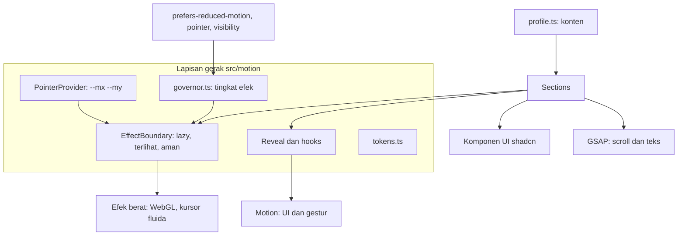

# ARCHITECTURE.md: Arsitektur Web Portofolio Futuristik

Menjelaskan struktur kode, batas tanggung jawab, dan keputusan teknis. Untuk tampilan lihat `DESIGN.md`, untuk persyaratan lihat `TRD.md`.

## 1. Gambaran

Situs statis satu halaman. Tidak ada backend, basis data, atau login. Semua isi berasal dari satu berkas data. Kerumitan ada di **lapisan gerak** (animasi dan efek kursor), jadi arsitektur ini berfokus mengendalikan lapisan itu: siapa memiliki animasi apa, kapan efek berat boleh jalan, dan bagaimana semuanya dibersihkan dan diturunkan kualitasnya.



## 2. Teknologi dan alasannya

| Keputusan | Pilihan | Alasan |
|---|---|---|
| Build | Vite, React, TypeScript | Cepat, tanpa kebutuhan SSR untuk situs satu halaman |
| Styling | Tailwind CSS, variabel CSS untuk token | Token warna dan gerak satu sumber |
| Komponen dasar | shadcn/ui (kode di repo) | Dimiliki penuh, tidak ada paket UI besar |
| Komponen efek | React Bits (kode sumber lewat CLI) | Gratis, dimiliki di repo, variannya `TS-TW` |
| Animasi UI | Motion | Mount/unmount, layout, gestur, nilai bergerak, spring |
| Animasi scroll dan teks | GSAP (`gsap`, `@gsap/react`), plugin ScrollTrigger dan SplitText | Linimasa scroll yang presisi, pemecahan teks |
| Router | Tidak ada | Satu halaman, anchor |
| Deploy | Vercel | Sudah dipakai |

Dependensi tambahan hanya yang diminta komponen React Bits yang disetujui pemilik (misalnya pustaka WebGL kecil). Tiap dependensi baru dicatat di bagian 8.

## 3. Struktur direktori

```
src/
  components/
    ui/                 komponen shadcn
    reactbits/          komponen React Bits yang disalin (tiap berkas diberi komentar sumber dan lisensi)
    sections/           Hero, About, Projects, Skills, Achievements, Contact, Footer
    layout/             Navbar, MobileMenu, ScrollProgress, EffectToggle
  motion/
    tokens.ts           durasi, easing, spring, stagger, jarak
    governor.ts         tingkat efek (full | lite | off) dan penurunan otomatis
    PointerProvider.tsx pendengar pointermove tunggal, variabel --mx --my
    EffectBoundary.tsx  pembungkus efek berat (lazy, terlihat, fallback, error boundary)
    Reveal.tsx          reveal masuk layar, sekali per elemen
    hooks/              useReducedMotion, useInView, usePointerFine, useEffectLevel
    gsap-setup.ts       registerPlugin, pemetaan easing, satu-satunya tempat mengimpor plugin GSAP
  data/
    profile.ts          semua konten pribadi
  styles/
    globals.css         token warna, font, gaya dasar, reduced-motion
  lib/
  main.tsx  App.tsx
public/                 favicon, og-image.png, robots.txt, sitemap.xml
vercel.json             header keamanan
tests/                  e2e Playwright
```

## 4. Aturan kepemilikan animasi

Aturan inti: **satu elemen, satu pemilik animasi.**

| Pemilik | Wilayah | Contoh |
|---|---|---|
| CSS | Keadaan sederhana tanpa logika | Transisi hover warna, sorotan lokal kartu (variabel `--x`, `--y`), animasi ambient L2, marquee |
| Motion | Elemen React yang masuk dan keluar, layout, gestur, nilai bergerak | Kartu proyek yang membuka detail (layout), tombol magnetik, pengikut kursor, reveal sederhana |
| GSAP | Hal yang bergantung pada posisi scroll dan pemecahan teks | Garis linimasa yang tergambar, animasi masuk judul per kata, bagian yang terhubung scroll |
| Komponen React Bits | Dalam batasnya sendiri | Latar L3, jika disetujui |

Pelanggaran yang harus dihindari: Motion dan GSAP sama-sama menganimasikan `transform` pada elemen yang sama; membungkus komponen React Bits dengan animasi `transform` lain; mengubah variabel CSS yang dipakai animasi CSS dari dua tempat.

## 5. Modul lapisan gerak

### 5.1 `governor.ts`

Tanggung jawab: menentukan tingkat efek saat ini (`full`, `lite`, `off`) dan memberi tahu pelanggan jika berubah.

Masukan:
- `prefers-reduced-motion` (selalu menang, memaksa `off`).
- Pilihan pengguna dari `EffectToggle` (`localStorage` dengan `try/catch`).
- Kemampuan: `(hover: hover) and (pointer: fine)`; indikasi perangkat (`hardwareConcurrency`, jika ada). Indikasi ini hanya menentukan titik awal, bukan keputusan akhir.
- Ukuran frame nyata: rata-rata durasi frame saat efek berat aktif. Jika terus lambat (sekitar 24 ms ke atas), turun ke `lite` dan jangan naik lagi pada sesi yang sama.

Antarmuka yang diharapkan:

```ts
export type EffectLevel = "full" | "lite" | "off";
export function getLevel(): EffectLevel;
export function setUserLevel(level: EffectLevel | "auto"): void;
export function subscribe(fn: (level: EffectLevel) => void): () => void;
export function reportFrameTime(ms: number): void; // dipanggil efek berat
```

Fungsi murni (pemilihan tingkat dari masukan) dipisahkan dari pendengar browser supaya bisa diuji unit.

Kait uji: setiap kali tingkat berubah, governor menulis `document.documentElement.dataset.effects = level`. Pengikut kursor memakai `data-testid="cursor-follower"` dan latar L3 memakai `data-testid="bg-l3"`. Kait ini dipakai oleh `TESTING-GUIDE.md`.

### 5.2 `PointerProvider.tsx`

- Satu `pointermove` pasif di `window`. Menyimpan posisi terakhir, lalu satu `requestAnimationFrame` menulis `--mx`, `--my` (piksel) dan `--mxp`, `--myp` (0 sampai 1) ke `document.documentElement`.
- Menyediakan `MotionValue` x dan y untuk efek yang membutuhkannya (pengikut kursor).
- Tidak aktif jika bukan `(hover: hover) and (pointer: fine)` atau tingkat bukan `full`.
- Loop berhenti jika tidak ada gerak untuk beberapa detik dan tab tersembunyi.
- Tidak menyebabkan render ulang komponen React.

### 5.3 `EffectBoundary.tsx`

Pembungkus wajib untuk efek tier 2 dan 3. Perilaku:

1. Memuat komponen secara malas (`React.lazy`) hanya jika tingkat mengizinkan efek itu.
2. Merender hanya saat berada di layar (`IntersectionObserver`), dan melepas saat keluar jauh dari layar.
3. Berhenti saat tab tersembunyi.
4. Membungkus `ErrorBoundary`. Jika WebGL gagal (konteks hilang, tidak didukung), tampilkan cadangan statis (gradien CSS) dan catat peringatan ke konsol.
5. Menerima properti `tier` (1, 2, atau 3) dan `fallback`.

### 5.4 `Reveal.tsx` dan hooks

- `Reveal`: membungkus anak, animasi masuk sekali saat pertama terlihat (`opacity` dan `translateY` sebesar `distance.reveal`). Pada tingkat `off`, langsung tampil tanpa gerak.
- `useInView`: pembungkus `IntersectionObserver` dengan opsi `once`.
- `useReducedMotion`, `usePointerFine`, `useEffectLevel`: membaca media query dan governor.

### 5.5 `gsap-setup.ts`

Satu-satunya berkas yang mengimpor dan mendaftarkan plugin GSAP. Komponen yang memakai GSAP memakai `useGSAP` dari `@gsap/react` dengan `scope`, sehingga `revert` otomatis saat dilepas. Dalam mode `off`, tidak menjalankan animasi dan memasang status akhir.

## 6. Model data

```ts
// src/data/profile.ts (isi nilai oleh pemilik)
export type Project = { title: string; summary: string; tags: string[]; demo?: string; repo?: string; image?: string };
export type Achievement = { title: string; issuer: string; date: string; url?: string };

export const profile = {
  name: "{{ISI_SENDIRI}}",
  role: "{{ISI_SENDIRI}}",
  tagline: "{{ISI_SENDIRI}}",
  status: "" as string,            // contoh: teks label HUD, hanya jika benar
  about: ["{{ISI_SENDIRI}}"] as string[],
  links: { github: "", linkedin: "", email: "", whatsapp: "" },
  projects: [] as Project[],
  achievements: [] as Achievement[],
  skills: {} as Record<string, string[]>,
};
```

Komponen hanya membaca `profile`. Validasi sederhana (tipe TypeScript dan pemeriksaan protokol URL `https:`, `mailto:`, `tel:`) pada saat render.

## 7. Aliran saat berjalan

1. Halaman dimuat: HTML dan CSS dasar, `governor` menentukan tingkat awal.
2. Hero tampil dengan animasi masuk. Latar L0 sampai L2 langsung. L3 dimuat malas jika tingkat `full`.
3. `PointerProvider` mulai jika perangkat berkursor halus dan tingkat `full`.
4. Scroll: `Reveal` dan ScrollTrigger memicu animasi masuk. `EffectBoundary` memasang atau melepas efek menurut keterlihatan.
5. `governor` memantau frame. Jika lambat, tingkat turun dan pelanggan (efek berat) berhenti dan diganti cadangan.
6. Pengguna dapat mengganti tingkat dari footer kapan saja.

## 8. Keputusan arsitektur (ADR ringkas)

| # | Keputusan | Alasan | Konsekuensi |
|---|---|---|---|
| 1 | Motion dan GSAP, tanpa Anime.js dan React Spring | Satu pustaka per kebutuhan, bundel lebih kecil, tidak ada rebutan `transform` | Efek dari pustaka lain harus ditulis ulang dengan dua pustaka ini |
| 2 | Komponen React Bits disalin sebagai sumber | Dimiliki penuh dan tanpa ketergantungan runtime pada paket UI | Pemutakhiran manual. Setiap berkas memuat sumber dan lisensi |
| 3 | Efek kursor lewat variabel CSS dan `MotionValue` | Tidak ada render ulang React per gerak kursor | Efek harus dirancang berbasis variabel, bukan state |
| 4 | Tiga tingkat efek dengan penurunan otomatis dari ukuran frame | Heuristik perangkat tidak akurat | Butuh modul `governor` dan pengujian |
| 5 | Tanpa preloader dan tanpa smooth-scroll berbasis pustaka | Menunda konten, mengubah perilaku scroll bawaan, merugikan aksesibilitas | Gerak scroll hanya lewat ScrollTrigger yang menghormati scroll native |
| 6 | Gelap saja | Menyederhanakan kontras dan efek cahaya | Mode terang jadi fase 2 |
| 7 | Tanpa backend, tanpa formulir | Permukaan serangan kecil | Kontak lewat tautan |

## 9. Dependensi yang disetujui

| Paket | Tujuan | Lisensi | Catatan |
|---|---|---|---|
| `motion` | Animasi UI | MIT | Impor yang diperlukan saja |
| `gsap`, `@gsap/react` | Scroll dan teks | Lisensi standar GSAP (gratis, termasuk komersial) | Larangan utamanya terkait pembuatan pembangun animasi visual pesaing, tidak berlaku untuk portofolio |
| `lucide-react` | Ikon | Periksa saat memasang | Impor ikon satu per satu |
| Komponen React Bits yang disetujui | Teks, latar, kursor | Menurut halaman GitHub proyeknya: MIT dengan Commons Clause. Baca `LICENSE.md` di repo mereka | Tiap komponen dicatat di tabel di bawah |
| Pustaka WebGL kecil | Hanya jika komponen L3 yang disetujui membutuhkannya | Periksa | Dimuat malas, tidak masuk bundel awal |

Catatan lisensi: kata Commons Clause pada React Bits membatasi menjual perangkat lunaknya itu sendiri. Memakainya di portofolio pribadi bukan menjualnya, tetapi pemilik sebaiknya membaca teks lisensi sendiri, karena saya tidak memberi nasihat hukum.

Tabel komponen yang disalin (diisi agen saat memasang):

| Komponen | Sumber (URL) | Dependensi tambahan | Ukuran | Disetujui pemilik |
|---|---|---|---|---|
| (kosong) | | | | |

## 10. Batasan

- Tidak ada SSR, jadi isi awal muncul setelah JavaScript dimuat. Metadata SEO tetap ada di HTML statis, tetapi mesin pencari dan pratinjau tautan hanya melihat HTML awal. Jika SEO penting, pertimbangkan prerender di fase 2.
- Heuristik kemampuan perangkat tidak sempurna. Karena itu ada kendali manual.
- WebGL tidak tersedia di semua perangkat. Karena itu ada cadangan statis.
